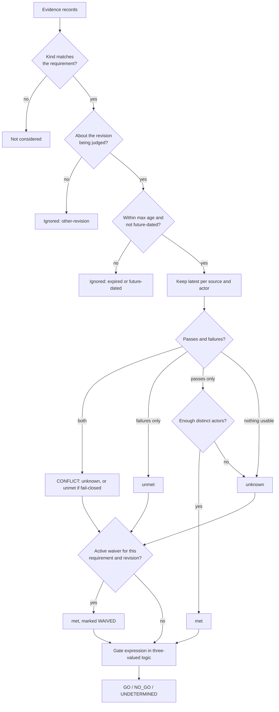

# evidence-gate

Decide whether a revision is ready to release from **evidence**, and answer with one of three
verdicts: `GO`, `NO_GO`, or `UNDETERMINED`.

> An independent reference implementation, written from scratch for demonstration. It is not
> extracted from any production system, and all example data is fictional. Built with AI coding
> assistance (Claude Code).

## The problem

A release gate that can only answer yes or no has to decide, somewhere, what "no data" means. A check
that never ran, a scan from last week, a health probe that looked at the previous deploy: each one
gets rounded to green or to red, and the rounding is usually invisible.

Both roundings cost something. Rounding to green ships a revision nobody actually checked.
Rounding to red teaches people that the gate is noisy, and a gate people route around protects
nothing.

`evidence-gate` keeps the third answer. Every requirement is `met`, `unmet` or `unknown`,
the gate combines them with three-valued logic, and the verdict says which of the three it is and
why. "We cannot tell yet" becomes a result a pipeline can act on, separate from "no".

## What it does

- **Policy as data.** A JSON policy lists requirements and a gate expression (`all`, `any`, `not`)
  over them.
- **Evidence is about one revision.** A passing test run for a different commit is not evidence.
  It is reported as set aside, with the reason.
- **Evidence expires.** A requirement can set `maxAgeMinutes`. Expired evidence counts as unknown
  in both directions: an old pass does not approve, and an old failure does not block.
- **Re-runs supersede; sources that disagree conflict.** The latest observation from a source
  replaces its earlier ones. When two different sources disagree about the same revision, the
  requirement is `unknown` (or `unmet`, if the policy says to fail closed).
- **Distinct actors.** "Two approvals" means two different people, counted by `actor`.
- **Waivers are explicit.** A waiver names a requirement, a revision, an approver, a reason and an
  expiry. The report still shows what the evidence said and flags that the verdict depends on a
  waiver.
- **Every verdict is explained and reproducible.** The report cites the evidence ids each state
  rests on, lists what was ignored and why, and carries a SHA-256 of its canonical inputs. The
  clock is an input, so the same inputs always give the same report.
- **Exit codes for CI.** `0` GO, `1` NO_GO, `2` UNDETERMINED, `3` invalid input. Malformed input is
  never mistaken for a verdict.

## How evaluation works



The gate uses strong Kleene logic. A single unmet operand decides an `all`, and a single met
operand decides an `any`, even when the other operands are unknown. Otherwise unknown propagates.

| `all` | met | unknown | unmet |
| --- | --- | --- | --- |
| **met** | met | unknown | unmet |
| **unknown** | unknown | unknown | unmet |
| **unmet** | unmet | unmet | unmet |

## Quickstart

Requires Node.js 22 or later.

```bash
npm install
npm test
npm run gate -- \
  --policy examples/policy.json \
  --evidence examples/evidence/undetermined.json \
  --revision 4be1c02 \
  --now 2026-03-02T12:00:00Z
```

Output (exit code `2`):

```text
policy    service-release
revision  4be1c02
as of     2026-03-02T12:00:00.000Z

VERDICT   UNDETERMINED

  met      tests-pass         PASSED
                              passing observation from ci/main-pipeline
  met      lint-pass          PASSED
                              passing observation from ci/main-pipeline
  unknown  review-approved    INSUFFICIENT_ACTORS
                              1 of 2 required distinct actors
  unknown  dependency-scan    EXPIRED
                              the only `scan.dependencies` evidence for 4be1c02 is older than 1440 min
  unknown  staging-healthy    WRONG_REVISION
                              `deploy.staging-health` evidence exists, but none of it is about 4be1c02
  unknown  canary-healthy     MISSING
                              no `deploy.canary-health` evidence for 4be1c02
  unknown  changelog-updated  MISSING  [advisory]
                              no `docs.changelog` evidence for 4be1c02

To settle it:
  - review-approved: another distinct actor must supply passing evidence
  - dependency-scan: re-run the check; the last observation is too old to rely on
  - staging-healthy: run the check against this exact revision
  - canary-healthy: collect this evidence for the revision

inputs sha256  805a05ddf03fbde59bf35efb99ea90d3bc018be723b495545cb308495712f5e4
```

Swap in `examples/evidence/go.json` (exit `0`) or `examples/evidence/no-go.json` (exit `1`) to see
the other verdicts. Add `--format json` for the machine-readable report, and
`--waivers examples/waivers.json` to apply a waiver. `--evidence` accepts a `.json` file, a
`.jsonl` file or a directory of them, and can be repeated. Omit `--now` to use the current time.

After `npm run build`, the same CLI is available as `node dist/cli.js`.

## Policy and evidence

A policy ([examples/policy.json](examples/policy.json)):

```json
{
  "version": 1,
  "name": "service-release",
  "requirements": [
    { "id": "tests-pass", "description": "The test suite passed on this revision", "kind": "ci.tests" },
    { "id": "review-approved", "description": "Two different people approved the change", "kind": "review.approval", "minDistinctActors": 2 },
    { "id": "staging-healthy", "description": "Staging health check passed in the last two hours", "kind": "deploy.staging-health", "maxAgeMinutes": 120 },
    { "id": "canary-healthy", "description": "Canary health check passed in the last two hours", "kind": "deploy.canary-health", "maxAgeMinutes": 120 }
  ],
  "gate": {
    "all": [
      { "req": "tests-pass" },
      { "req": "review-approved" },
      { "any": [{ "req": "staging-healthy" }, { "req": "canary-healthy" }] }
    ]
  }
}
```

A requirement that the gate does not reference is advisory: it is evaluated and reported, and it
never decides the verdict.

An evidence record:

```json
{
  "id": "ev-004",
  "kind": "review.approval",
  "revision": "4be1c02",
  "outcome": "pass",
  "observedAt": "2026-03-02T10:05:00Z",
  "source": "code-review",
  "actor": "reviewer-ana"
}
```

`observedAt` must carry a UTC offset. A local time with no offset is rejected, because a gate that
reasons about evidence age cannot work from an ambiguous instant.

## Use as a library

```ts
import { evaluate, parsePolicy, parseEvidenceList } from "evidence-gate";

const report = evaluate({
  policy: parsePolicy(rawPolicy),
  evidence: parseEvidenceList(rawEvidence),
  revision: "4be1c02",
  now: new Date(),
});

if (report.verdict !== "GO") {
  for (const r of report.requirements) console.log(r.id, r.state, r.reason, r.explanation);
}
```

There are no runtime dependencies.

## Design tradeoffs

- **Three values, not a score.** A weighted score hides which requirement was missing. Three
  explicit states keep each requirement inspectable and make the combination rule a small truth
  table anyone can check.
- **Expired is unknown in both directions.** Letting an old failure block forever would be the
  "safe" choice, and it would also make the gate's answer depend on evidence the policy itself
  says is too old to trust. The policy author can still fail closed by requiring fresh evidence.
- **Conflict defaults to unknown.** When two sources disagree, picking the newer or the stricter
  one is a guess. The default surfaces the disagreement; `onConflict: "unmet"` is available for
  checks where any failure should stop a release.
- **The clock is an input.** `evaluate` never reads the system time. Tests are deterministic, and
  a past verdict can be recomputed exactly.
- **Waivers change the gate, not the record.** A waived requirement still reports the state its
  evidence supports, so a waiver cannot quietly turn into "it passed".
- **Policy as JSON, not a rule language.** `all`/`any`/`not` over named requirements covers the
  common release shapes and stays readable in review. Richer conditions (thresholds, per-path
  rules) are deliberately out of scope.

More detail is in [docs/design.md](docs/design.md).

## Status

| Capability | State |
| --- | --- |
| Three-valued evaluation, gate expressions, advisory requirements | Implemented and tested |
| Revision binding, evidence age, clock-skew handling, supersession, conflict modes | Implemented and tested |
| Distinct-actor counting, waivers, reproducibility digest | Implemented and tested |
| Input validation, CLI, text and JSON reports, exit codes | Implemented and tested |
| Collectors that produce evidence from a CI system or deploy platform | Not implemented. Evidence is supplied as JSON files |
| Signed or attested evidence (verifying who really produced a record) | Conceptual. Records are trusted as given |
| Persistent evidence store, history of past verdicts | Not implemented |

Checked during the build with `npm run lint`, `npm run typecheck`, `npm test` (62 tests) and
`npm run build`.

## Limitations

- Evidence is trusted as supplied. Nothing here authenticates a record's `source` or `actor`, so
  in real use the files must come from a path the pipeline controls.
- This is the decision step only. Collecting evidence and acting on the exit code are the
  pipeline's job.
- Outcomes are `pass` or `fail`. Numeric thresholds (coverage, latency) would need to be reduced
  to pass/fail by whatever produces the evidence.

## License

[MIT](LICENSE)
